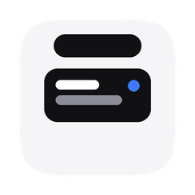
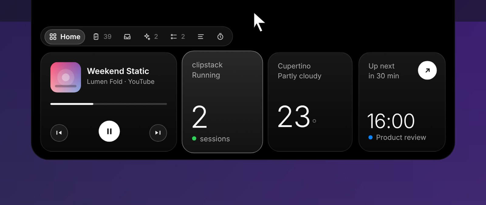
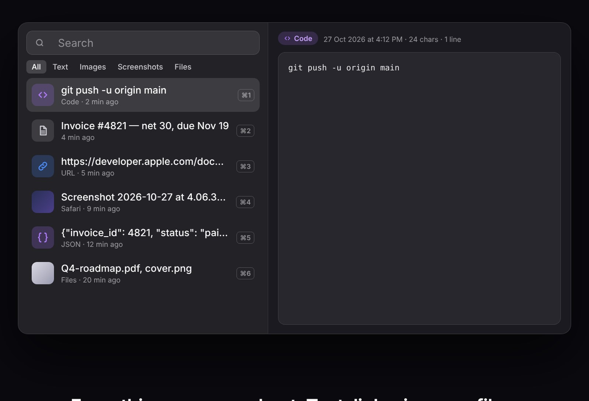
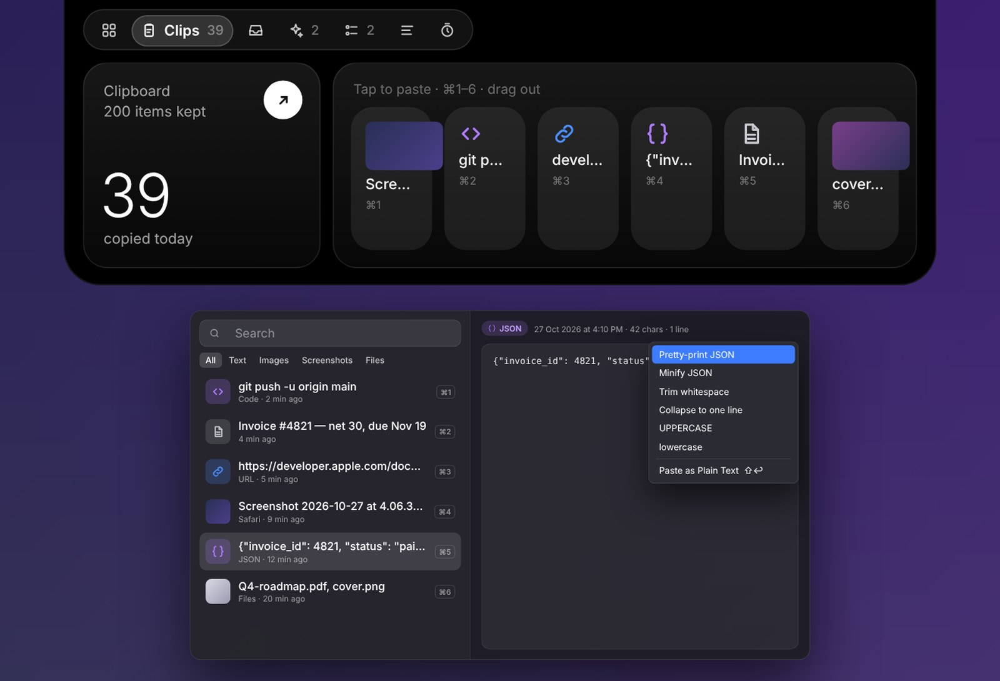
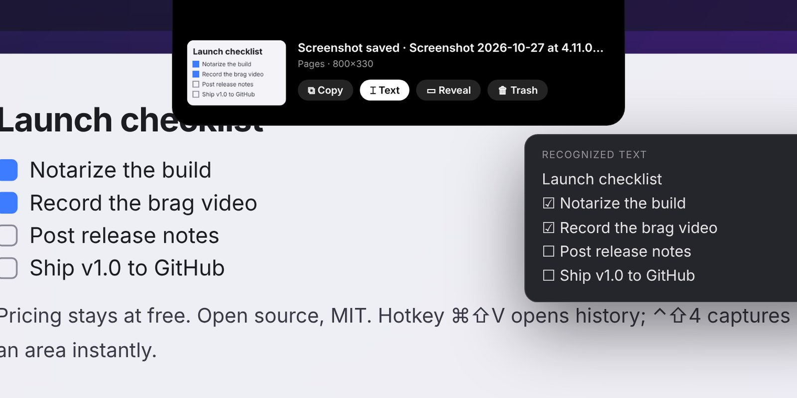
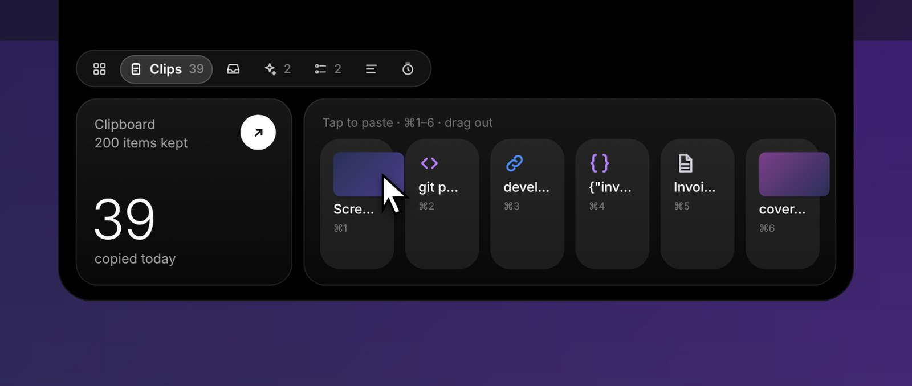
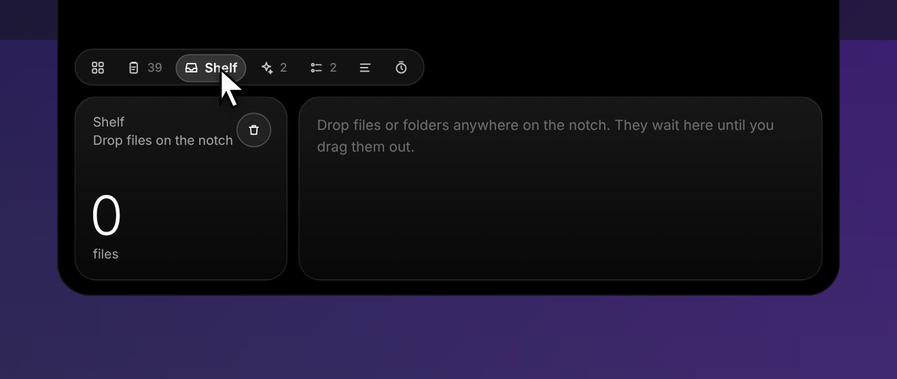
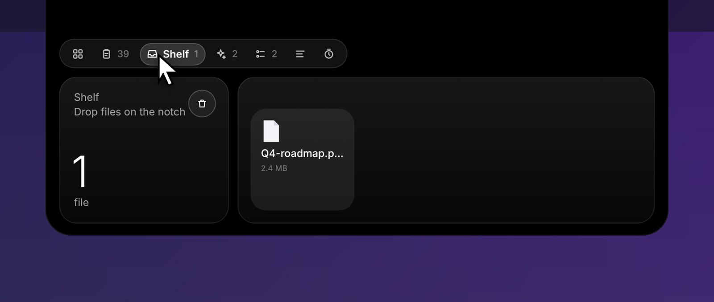
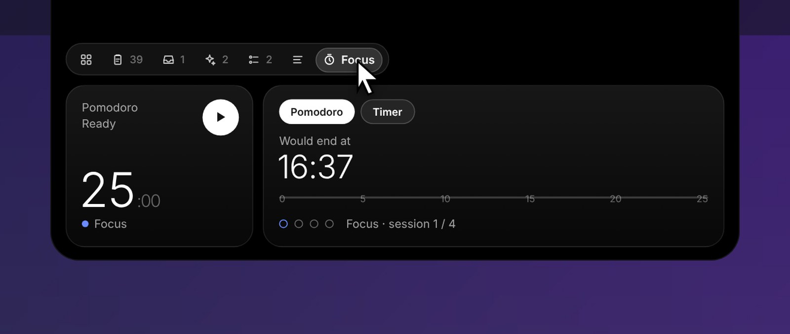
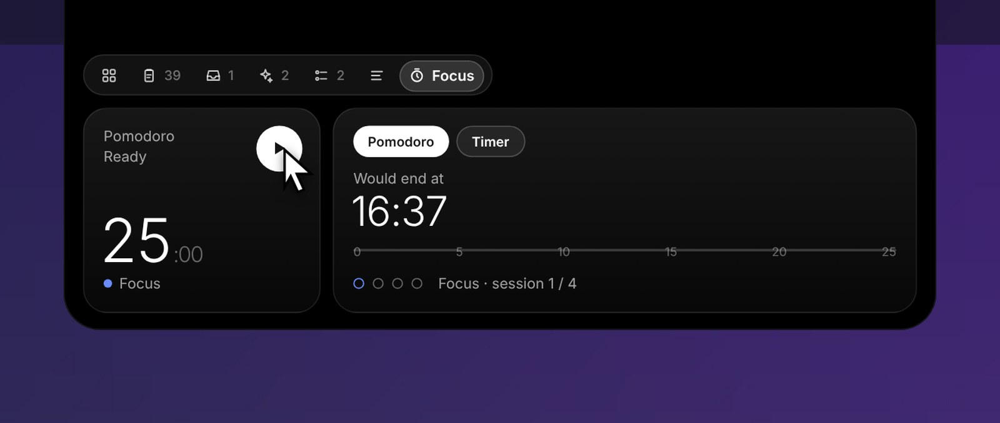

<p align="center">
  
</p>
<h1 align="center">ClipStack</h1>
<p align="center">
  Clipboard history, screenshots with OCR, and a living notch for your Mac.<br>
  Free, open source, pure AppKit. No accounts, no cloud, no telemetry.
</p>
<p align="center">
  <a href="https://github.com/OWNER/ClipStack/releases/latest"><b>Download</b></a> ·
  <a href="#install">Install</a> ·
  <a href="#the-island">The island</a> ·
  <a href="#build-from-source">Build</a> ·
  <a href="CHANGELOG.md">Changelog</a>
</p>

<p align="center"></p>

## Install

**One line** (downloads the latest signed build, or builds from source if there is no release yet):

```bash
curl -fsSL https://raw.githubusercontent.com/OWNER/ClipStack/main/install.sh | bash
```

Or grab the DMG from [Releases](https://github.com/OWNER/ClipStack/releases/latest) and drag ClipStack to Applications.
macOS 13 Ventura or later. Works on every Mac; the island needs a MacBook with a notch (other Macs get a small pill at the top of the screen).

## What it does

### Clipboard history
Everything you copy is kept: text, rich text, images, files. Press **⌘⇧V** to search it. **⌘1–⌘9** pastes the Nth item anywhere, **⇧⏎** pastes as plain text. Pin what matters, and passwords from password managers are never recorded.

<p align="center"></p>

### Smart types, one-click actions
ClipStack knows what you copied. JSON gets pretty-print and minify. URLs open, or lose their tracking params. Colors convert between hex and rgb(). Text gets trim, case changes, dedupe and sort lines.

<p align="center"></p>

### Screenshots, with the text inside them
Capture with **⌃⇧3 / ⌃⇧4 / ⌃⇧5** and the shot lands in your history instantly, OCR'd on-device so you can search it and copy the text out. Optional monthly folders and date + app naming.

<p align="center"></p>

## The island

Hover the notch and it unfolds into a Dynamic-Island-style surface. Tabs: **Home**, **Clips**, **Shelf**, **Agents**, **Up Next**, **Prompter**, **Focus**.

| | |
|---|---|
| **Now Playing** | Spotify, Apple Music, and YouTube / YouTube Music in Chrome, Brave, Edge or Arc. Album art in the wing, controls in the card. |
| **Agents** | Claude Code permission requests appear in the notch. **Allow** or **Deny** without switching windows. The notch glows orange while an agent waits. |
| **Shelf** | Drop files on the notch. They wait there until you drag them out into any app. |
| **Focus** | Pomodoro and timers, with a countdown ring in the notch wing. |
| **Up Next** | Next calendar event with a Join button for Zoom / Meet / Teams, plus today's reminders. Opt-in. |
| **Weather** | Current conditions in the corner. Opt-in. |
| **Prompter** | Scrolls your last copied text, for reading a script on camera. |

<p align="center"></p>
<p align="center"></p>
<p align="center"></p>
<p align="center"></p>
<p align="center"></p>

Accidental opens are prevented with hover intent (half a second by default, or click only). Drags open the island instantly.

## Claude Code integration

Preferences → Agents → **Install Claude Code Hooks** adds a `PermissionRequest` hook to `~/.claude/settings.json`. The hook posts to a local server on `127.0.0.1:48766`, and your answer in the notch is returned to Claude Code. Nothing leaves your machine.

## Permissions

| Feature | Permission | Why |
|---|---|---|
| Auto-paste | Accessibility | Sends a synthetic ⌘V after you pick an item. Optional. |
| Now Playing (browsers) | Automation, plus View ▸ Developer ▸ *Allow JavaScript from Apple Events* in the browser | Reads the page's media session. |
| Up Next | Calendars, Reminders | Opt-in. |
| Weather | Location | Opt-in. |

The global hotkey and the clipboard history need no permissions.

## Build from source

Needs Command Line Tools with Swift 5.9 or newer. No Xcode, no dependencies.

```bash
git clone https://github.com/OWNER/ClipStack.git && cd ClipStack
./build-app.sh        # builds dist/ClipStack.app, quits any running copy, launches the new one
```

Update later with `git pull && ./build-app.sh`. Maintainers: `./release.sh 1.0.0` signs, notarizes and packs the DMG (see the script header for the one-time setup).

## Privacy

History lives in `~/Library/Application Support/ClipStack/`. ClipStack makes no network requests except weather (Open-Meteo, only if you turn it on). There is no analytics, no account, and no update check.

## Layout

| File | Purpose |
|---|---|
| `ClipStore.swift`, `ClipItem.swift`, `ClipboardMonitor.swift` | History model, persistence, pasteboard polling |
| `SmartType.swift`, `Paster.swift` | Content detection, transforms, paste |
| `HistoryView.swift`, `PreferencesWindow.swift` | History popover and preferences |
| `NotchWindow.swift`, `IslandUI.swift` | The notch panel, shape morphing, island tabs |
| `ScreenshotCapture.swift`, `ScreenshotWatcher.swift` | Capture shortcuts, folder watcher, Vision OCR |
| `AgentMonitor.swift` | Local hook server for Claude Code |
| `NowPlaying.swift`, `CalendarMonitor.swift`, `Weather.swift`, `Shelf.swift` | Island data sources |

## License

[MIT](LICENSE)
